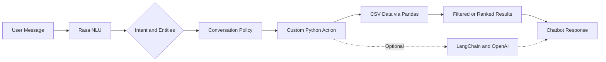

<div align="center">

# 🎬 Movie Recommendation Chatbot

**An intelligent, conversational movie assistant built with Rasa and powered by IMDb and box-office datasets.**

[](https://www.python.org/)
[](https://rasa.com/)
[](LICENSE)
[](https://pandas.pydata.org/)

[Overview](#-overview) • [Features](#-features) • [How It Works](#-how-it-works) • [Quick Start](#-quick-start) • [Usage](#-usage) • [Project Structure](#-project-structure)

</div>

## 📖 Overview

**Movie Recommendation Chatbot** is a natural-language assistant that helps users discover and explore movies. It uses Rasa NLU to understand conversational intents and custom Python actions to query local movie datasets.

The chatbot can search for a film, return release and rating information, list top-rated or highest-grossing titles, recommend movies by year or genre, and find movies similar to a title.

An optional LangChain/OpenAI integration can generate richer descriptions and recommendations, but the bot also works in a fully local fallback mode without an API key.

> **Repository name:** *movie-reccomendation-chatbot* (preserved exactly as it appears on GitHub)

## ✨ Features

- **Movie search** — Find a title and retrieve ranking, release year, genre, and rating data.
- **Top-rated movies** — Browse highly rated titles from the IMDb dataset.
- **Highest-grossing movies** — Explore commercially successful films.
- **Cross-referenced rankings** — Identify movies that appear in both datasets.
- **Personalized recommendations** — Filter suggestions by genre or release year.
- **Similar movie discovery** — Ask for films related to a title you already enjoy.
- **Optional AI-generated summaries** — Enhance descriptions with OpenAI through LangChain.
- **Graceful fallback behavior** — Continue using dataset-driven responses if LangChain or an API key is unavailable.
- **Custom NLU entities** — Recognize movies, years, ratings, genres, directors, and actors.

## 💬 Example Conversations

```text
You:  Hello
Bot:  Hey! How can I help you with movies today?

You:  What are the top-rated movies?
Bot:  Here are the top 5 highest-rated movies according to IMDb:

You:  Tell me about The Godfather
Bot:  The Godfather (1972) — ranked in the highest-grossing and top-rated movies...

You:  Show me movies from 2008
Bot:  Here are some notable movies from 2008:

You:  Recommend me a good movie
Bot:  Here are some excellent movies you might enjoy:
```

Supported request types include:

- `"What are the highest-grossing movies?"`
- `"Which movies are both top-rated and highest-grossing?"`
- `"Tell me more about Inception"`
- `"What is the rating of Pulp Fiction?"`
- `"What movies are similar to The Matrix?"`
- `"Show me movies released in 1994"`
- `"Recommend a good movie"`

## 🧠 How It Works

1. **NLU processing** — Rasa identifies the user's intent and extracts entities such as movie title and year.
2. **Conversation policy** — Rasa rules and stories decide the next bot action.
3. **Data loading** — Custom actions load and normalize `raw_wiki_movies.csv` and `raw_imdb_movies.csv` with Pandas.
4. **Cross-referencing** — Titles are normalized and matched across both datasets.
5. **Response generation** — Custom actions rank, filter, and format movie suggestions.
6. **Optional enhancement** — LangChain can generate conversational descriptions when `OPENAI_API_KEY` is configured.



## 🛠️ Tech Stack

| Component | Technology |
|---|---|
| Conversational framework | [Rasa 3.6.2](https://rasa.com/) |
| Programming language | Python |
| Data processing | Pandas, NumPy |
| Data format | CSV and YAML |
| Optional AI enhancement | LangChain and OpenAI |
| License | MIT |

## ✅ Prerequisites

- Python 3.8 or newer
- `pip`
- Python virtual environment support
- Optional: an OpenAI API key for generated descriptions

## 🚀 Quick Start

### 1. Clone the repository

```bash
git clone https://github.com/R0hithReddyG/movie-reccomendation-chatbot.git
cd movie-reccomendation-chatbot
```

### 2. Create and activate a virtual environment

**macOS/Linux**

```bash
python3 -m venv .venv
source .venv/bin/activate
```

**Windows**

```powershell
python -m venv .venv
.venv\Scripts\activate
```

### 3. Install dependencies

```bash
python -m pip install --upgrade pip
python -m pip install -r requirements.txt
```

### 4. Train the Rasa model

```bash
rasa train
```

### 5. Start the action server

Open a terminal and run:

```bash
rasa run actions
```

### 6. Chat with the bot

Open another terminal and run:

```bash
rasa shell
```

Type a request such as:

```text
What are the highest-grossing movies?
```

Press `Ctrl+C` to exit the shell.

## 🔑 Optional OpenAI Configuration

LangChain is optional. If no API key is available, the chatbot automatically uses its built-in dataset-driven responses.

**macOS/Linux**

```bash
export OPENAI_API_KEY="your-api-key"
```

**Windows PowerShell**

```powershell
$env:OPENAI_API_KEY="your-api-key"
```

Restart the action server after setting the environment variable.

> Never commit real API keys or expose them in source-controlled files.

## 🌐 Running with Rasa REST APIs

Start the action server:

```bash
rasa run actions
```

Start the Rasa API server on a separate terminal:

```bash
rasa run --enable-api --cors "*"
```

Send a test message:

```bash
curl -X POST http://localhost:5005/webhooks/rest/webhook \
  -H "Content-Type: application/json" \
  -d '{"sender":"user1","message":"What are the top-rated movies?"}'
```

The default REST webhook is served by Rasa on port `5005`.

## 📁 Project Structure

```text
movie-reccomendation-chatbot/
├── actions/
│   └── actions.py          # Custom Rasa actions and recommendation logic
├── data/
│   ├── nlu.yml             # Intents and entity examples
│   ├── rules.yml           # Conversation rules
│   └── stories.yml         # Example conversation flows
├── data_loader.py          # Standalone CSV loading and merging utility
├── config.yml              # Rasa NLU pipeline and dialogue policies
├── domain.yml              # Intents, entities, slots, responses, and actions
├── endpoints.yml           # Rasa endpoint configuration
├── raw_imdb_movies.csv     # Top-rated IMDb movie data
├── raw_wiki_movies.csv     # Highest-grossing movie data
├── requirements.txt        # Python dependencies
├── LICENSE                 # MIT license
└── README.md
```

## 🧩 Intent and Entity Overview

### Intents

- Greetings and general conversation
- Movie search and details
- Release year and rating queries
- Highest-grossing and top-rated lists
- Movie recommendations
- Similar movie discovery
- Combined top-rated and commercial-success queries

### Entities

- `movie`
- `year`
- `rating`
- `genre`
- `director`
- `actor`

Custom slots are maintained by `domain.yml`, allowing a recognized movie or year to provide context for follow-up questions.

## 🧪 Testing and Development

Validate Rasa configuration:

```bash
rasa data validate
```

Test conversation flows interactively:

```bash
rasa shell
```

Run an action-server-only development session:

```bash
rasa run actions --debug
```

Test the standalone data loader:

```bash
python data_loader.py
```

## ⚠️ Current Limitations

- Recommendations depend on the included static CSV datasets rather than a live movie API.
- Search quality depends on title matching and the available columns in the dataset.
- `LangChain` and `OpenAI` support is optional and not required for core functionality.
- Movie year and rating data should be treated as local snapshot data rather than live information.
- The included configuration is intended primarily for local development and experimentation.

## 🤝 Contributing

Contributions are welcome!

1. Fork the repository.
2. Create a descriptive feature branch:

   ```bash
   git checkout -b feature/improve-recommendations
   ```

3. Make your changes and test them with Rasa.
4. Validate the conversation data:

   ```bash
   rasa data validate
   ```

5. Submit a pull request with a clear description and test results.

## 📄 License

This project is licensed under the [MIT License](LICENSE).

## 👤 Author

Created and maintained by [R0hithReddyG](https://github.com/R0hithReddyG).

<div align="center">

If this project helped you, please consider giving it a ⭐ on GitHub.

</div>
